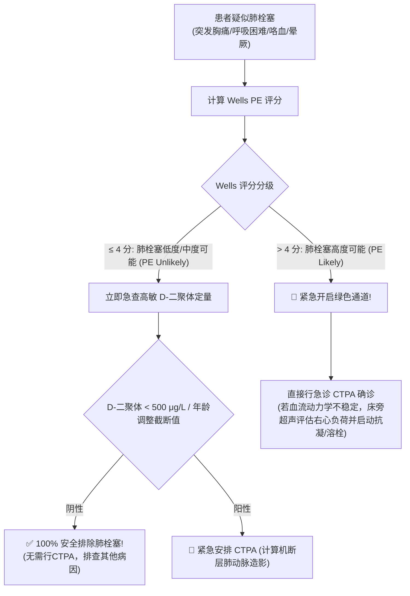

# Wells 肺栓塞 (PE) 临床概率预测评分规范

## 一、 临床背景与核心价值
肺栓塞（Pulmonary Embolism, PE）是突发胸痛与呼吸困难的致命病因之一。漏诊致死率极高，而盲目滥用 CT 肺动脉造影（CTPA）会带来过量放射辐射与造影剂肾病风险。

**Wells 评分**是国际及我国人卫版《诊断学》、《内科学》指南公认的**急性肺栓塞首选临床预测规则（Clinical Prediction Rule）**，用于决定是否需要行 D-二聚体检查或直接行 CTPA。

---

## 二、 Wells 评分 7 项量化指标与分值

| 评估项目 (Clinical Parameter) | 权重分值 | 临床特征与判定标准 |
| :--- | :---: | :--- |
| **深静脉血栓形成 (DVT) 的临床症状与体征** | **+3.0** | 单侧下肢明显肿胀、沿深静脉走行局限压痛、患侧小腿周径大于健侧 > 3 cm |
| **其他诊断的可能性小于肺栓塞** | **+3.0** | 经查体和病史，PE 是最可能或排在第一位的拟诊 |
| **心率 > 100 次/分 (心动过速)** | **+1.5** | 静息心率持续心动过速（窦性心动过速为 PE 最常见心电图表现） |
| **近 4 周内制动或接受大型手术** | **+1.5** | 卧床不起连续 ≥ 3 天，或 4 周内接受过全身麻醉/椎管内麻醉手术 |
| **既往有 DVT 或 PE 病史** | **+1.5** | 曾明确确诊过深静脉血栓或肺血栓栓塞症 |
| **咯血 (Hemoptysis)** | **+1.0** | 伴有痰中带血或小口鲜血（反映肺梗死） |
| **恶性肿瘤 (Active Cancer)** | **+1.0** | 正在接受抗肿瘤治疗、近 6 个月内接受过姑息治疗或已知转移性恶性肿瘤 |

---

## 三、 风险分层与临床决策路径 (两分法 vs 三分法)



---

## 四、 CDSS 智能计算规则输出示例
- **输入**:
  ```json
  {"dvt_signs": true, "pe_most_likely": true, "hr": 108, "recent_surgery": false, "prior_pe": false, "hemoptysis": false, "cancer": false}
  ```
- **输出**:
  ```json
  {
    "score": 7.5,
    "riskLevel": "HIGH",
    "peLikely": true,
    "recommendation": "肺栓塞高危 (Wells > 4分)，跳过单纯D-二聚体排查，强制紧急开具CTPA检查并准备低分子肝素抗凝",
    "grade": "1A"
  }
  ```
