# 便血与黑便鉴别诊断树与临床排查规范

## 一、 主诉特征与接诊问诊要点 (上消化道 vs 下消化道出血解剖定位)
便血是指消化道出血经肛门排出，包括鲜血便、暗红色便、果酱样便及柏油样黑便。接诊临床的核心在于**出血部位定位与失血量评估**：
1. **排便性状与解剖定位（屈氏韧带为界）**：
   - **柏油样黑便 (Melena)**：粪便黑亮、呈油漆样光泽、质软无臭或带特征性血腥味，多提示屈氏韧带以上的上消化道出血（胃十二指肠溃疡、糜烂性胃炎、肝硬化食管胃底静脉曲张破裂）。当出血量>50-70ml即可出现黑便；
   - **暗红色便或果酱样便**：高位下消化道出血（小肠、回盲部、右半结肠）或上消化道快速大出血（血液在肠道停留短不及硫化）；
   - **鲜血便**：低位直肠肛门出血（结肠左半侧、直肠肿瘤、痔疮、肛裂），血液常附着于成形大便表面或便后滴血、喷血。
2. **伴随全身表现**：有无头晕、心悸、眼黑、出冷汗、晕厥（反映急性循环血容量不足）。

---

## 二、 消化道出血致命“红旗征” (Red Flags)
> [!CAUTION] 具备以下任何一项特征，提示急性活动性大出血或周围循环衰竭，必须立即开启抢救流程：
- **失血性休克征象**：心率 > 100 次/分，收缩压 < 90 mmHg（或较基础血压下降 > 20 mmHg），四肢湿冷，烦躁不安，尿量 < 30 ml/h；
- **反复呕血或持续喷射性大量便血**：提示活动性动脉大出血或食管胃底静脉曲张大破裂（[[原发性肝癌]] 或肝硬化背景）；
- **体位性低血压**：平卧位转为坐位或立位时，收缩压下降 > 20 mmHg，心率增快 > 20 次/分（提示急性失血量已超总血容量的 15%～20%）；
- **中老年人无痛性便血伴大便习惯改变与进行性消瘦**：高度警惕 [[结直肠癌]]（不可轻易归因为痔疮！）。

---

## 三、 门诊阶梯鉴别诊断思维路径

```mermaid
flowchart TD
    A["患者主诉: 便血 / 黑便"] --> B{"是否存在失血性休克红旗征?<br>(血压下降/心率>100/湿冷晕厥)"}
    B -- "是" --> EMER["🚨 紧急抢救: 建立双静脉大通道/紧急输血/胃镜下止血或介入"]
    B -- "否" --> C{"大便性状与出血颜色"}
    
    C -- "柏油样黑便 + 上腹规律性隐痛 / 服NSAIDs史" --> UGI["👉 优先指向: 上消化道溃疡 / 糜烂性胃炎<br>(急查急诊胃镜确诊)"]
    C -- "柏油黑便/呕血 + 肝病面容/蜘蛛痣/腹水" --> EGV["👉 优先排查: [[原发性肝癌]] / 肝硬化门脉高压静脉曲张"]
    
    C -- "大便带血/黏液暗红血便 + 伴排便习惯改变/消瘦 (>45岁)" --> COLON["🚨 警惕高危: [[结直肠癌]] / 肠道息肉<br>(必须行直肠指检与结肠镜筛查)"]
    C -- "便后滴鲜血 / 手纸带鲜血 + 无痛 + 便在血前" --> HEMO["👉 优先指向: 内痔出血"]
    C -- "排便剧烈撕裂痛 + 鲜血滴落 + 便秘病史" --> FISS["👉 优先指向: 肛裂"]
    C -- "老年人突发左下腹绞痛后解暗红血便" --> ISCH["👉 优先排查: 缺血性结肠炎"]
```

---

## 四、 必备实验室与检查规范
1. **基础必查**：
   - 血常规（密切动态复查 Hb、Hct，由于血液浓缩，急性大出血早期 Hb 可能尚未明显下降）；
   - 凝血功能（PT, APTT, INR）及血型鉴定与交叉配血备血；
   - 肝肾功能（BUN 升高而 Cr 正常提示肠道吸收性氮质血症，支持上消化道出血）。
2. **内镜与指检金标准**：
   - **直肠指检 (DRE)**：门诊下消化道出血**必做的首要检查**（70% 的直肠癌可在指检范围内触及硬结或血染指套）；
   - 急诊胃镜（发病24～48小时内进行，既能确诊亦能止血）；
   - 结肠镜检查。

---

## 五、 门诊前置处方与安全禁忌红线
1. 🛑 **严禁对任何无明确检查依据的便血患者草率诊断为“痔疮”而放行，特别是年龄 > 40 岁、伴排便习惯改变者，必须强制排查 [[结直肠癌]]**！
2. 🛑 **活动性消化道大出血患者，严禁盲目给予口服刺激性止血药物或大量口服流质饮食**，需严格禁食，静脉应用质子泵抑制剂（PPI）或生长抑素类似物。
3. 🛑 **出血未停止期间，严禁使用非甾体抗炎药（NSAIDs）、阿司匹林、抗凝药物**。
