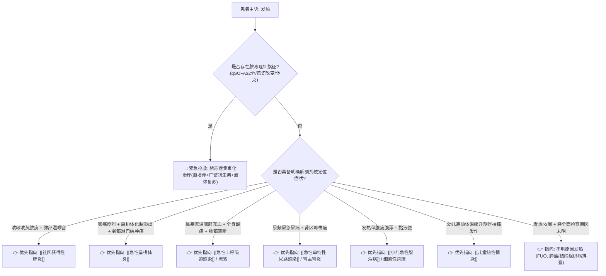

# 发热鉴别诊断树与临床排查规范

## 一、 主诉特征与接诊问诊要点 (热型与伴随系统定位)
发热是机体免疫系统对抗致病原或免疫异常的重要反应。门诊快速识别的关键在于**寻找感染灶定位证据与排除脓毒症**：
1. **热度与热型**：
   - 稽留热（体温持续39-40℃达数天，波动<1℃）：大叶性肺炎、伤寒；
   - 弛张热（体温在39℃以上，波动>2℃，但最低仍高于正常）：败血症、化脓性感染、风湿热；
   - 间歇热（高热与无热期交替）：疟疾、急性肾盂肾炎。
2. **伴随定位症状**：
   - 鼻塞流涕咽痛：上呼吸道；
   - 咳嗽、咳脓痰、胸痛：下呼吸道；
   - 尿频、尿急、尿痛伴腰痛：泌尿系统；
   - 腹痛、腹泻脓血便：胃肠道系统；
   - 剧烈头痛伴呕吐：中枢神经系统；
   - 关节红肿热痛：风湿免疫或化脓性关节炎。

---

## 二、 发热致命“红旗征” (Sepsis & Critical Flags)
> [!CAUTION] 发热患者若合并以下任一表现，必须启动急诊抗休克/抗脓毒症流程：
- **脓毒症休克早期迹象 (qSOFA ≥ 2分)**：
  - 呼吸频率 ≥ 22次/分；
  - 意识改变（嗜睡、烦躁、谵妄、Glasgow评分<15）；
  - 收缩压 ≤ 100 mmHg。
- **重症脑膜脑炎迹象**：高热伴剧烈头痛、喷射性呕吐、抽搐、脑膜刺激征阳性或皮肤瘀点瘀斑（提示流脑）。
- **粒细胞缺乏伴发热**：化疗后或免疫缺陷患者，外周血中性粒细胞绝对值 < 0.5×10⁹/L，属于高危致死性内科急症。
- **儿童高热危象**：超高热（>41℃）、精神萎靡拒奶、嗜睡、面色发灰、频繁抽搐（鉴别单纯 [[儿童热性惊厥]] 与中枢感染）。

---

## 三、 门诊阶梯鉴别诊断思维路径

---

## 四、 必备检验与排查规范
1. **基础必查**：
   - 血常规 + 白细胞手工分类 + CRP + 降钙素原（PCT，鉴别细菌与病毒感染）；
   - 尿常规（排除隐匿性泌尿道感染，特别是老年人及儿童无症状尿感）。
2. **靶向排查**：
   - 胸部低剂量 CT 或 X 线胸片（排查隐匿性肺部浸润实变）；
   - 发热峰值期血培养（双部位双瓶抽取，在应用抗菌药物前留取）；
   - 咽拭子流感病毒/新冠病毒/呼吸道合胞病毒核酸或抗原多联检。

---

## 五、 门诊前置处方与安全禁忌红线
1. 🛑 **严禁对普通病毒性上呼吸道感染常规、经验性滥用静脉或口服广谱抗菌药物（如头孢菌素、左氧氟沙星）**。
2. 🛑 **儿童发热严禁使用阿司匹林退热**，防止诱发致死性瑞氏综合征（Reye's syndrome）；优先选用对乙酰氨基酚或布洛芬。
3. 🛑 **未明确感染源前，严禁大剂量使用地塞米松等糖皮质激素单纯作为退热药**，极易导致严重感染扩散或掩盖病情。
