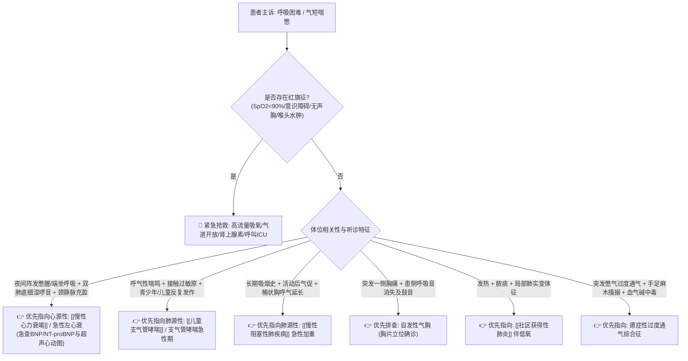

# 呼吸困难鉴别诊断树与临床排查规范

## 一、 主诉特征与接诊问诊要点 (心源性 vs 肺源性主轴)
呼吸困难是指患者主观感到空气不足、呼吸费力，客观表现为呼吸频率、节律或深浅度的异常。首诊临床的核心是**区分心源性还是肺源性呼吸困难**：
1. **起病急缓与诱发环境**：
   - 突发秒级/分钟级：急性气道异物梗阻、张力性气胸、大面积肺栓塞、过敏性喉头水肿；
   - 数小时至数日内加重：支气管哮喘急性发作、急性左心衰竭（心源性哮喘）、重症肺炎；
   - 慢性隐匿性进行性加重（数月至数年）：[[慢性阻塞性肺疾病]] (COPD)、[[慢性心力衰竭]] (CHF)、间质性肺疾病。
2. **体位与呼吸相特征**：
   - 吸气性呼吸困难伴吸气性三凹征及喉鸣：大气道狭窄/水肿/异物；
   - 呼气性呼吸困难伴双肺呼气相延长与哮鸣音：小气道痉挛（支气管哮喘、COPD急性加重）；
   - 端坐呼吸与夜间阵发性呼吸困难：典型左心衰竭，平卧后回心血量增加加重肺淤血。

---

## 二、 呼吸系统致命“红旗征” (Red Flags)
> [!CAUTION] 出现以下征象时，提示呼吸衰竭或循环衰竭临界状态，必须立即吸氧、监护并准备气道插管或抢救：
- **静息指脉氧饱和度 (SpO₂) < 90%**（且给氧后无法纠正）；
- **中枢性呼吸衰竭迹象**：呼吸表浅且极慢（< 10次/分）、节律不规整（潮式呼吸、间歇呼吸）、嗜睡、神志不清；
- **严重三凹征伴无声胸 (Silent Chest)**：重症哮喘发作时胸壁剧烈起伏但双肺呼吸音极低、哮鸣音消失（提示极度气道痉挛窒息风险）；
- **过敏性休克伴喉头水肿**：呼吸困难伴声音嘶哑、全身大面积风团皮疹（[[荨麻疹与过敏性皮炎]]）、血压骤降；
- **突发胸痛低氧伴单侧下肢粗肿**：高度警惕高危肺栓塞。

---

## 三、 门诊阶梯鉴别诊断思维路径

---

## 四、 必备实验室与检查规范
1. **急诊生化标志物**：
   - BNP 或 NT-proBNP 定量测定（心源性心衰与肺源性呼吸困难鉴别的核心金指标，阴性预测值极高）；
   - 动脉血气分析（PaO₂、PaCO₂、pH、乳酸，明确 I 型/II 型呼吸衰竭及酸碱失衡）；
   - 心肌酶谱与肌钙蛋白（cTnI）、D-二聚体（D-Dimer）。
2. **影像学**：床旁心肺超声（肺彗星尾征/B线评估肺水肿、下腔静脉塌陷率）、床旁胸片。

---

## 五、 门诊前置处方与安全禁忌红线
1. 🛑 **在无法排除心源性哮喘（急性左心衰）之前，绝对禁用非选择性 β 受体阻滞剂及肾上腺素皮下注射**。
2. 🛑 **在无法排除支气管哮喘（气道痉挛）之前，严禁盲目静脉注射吗啡镇静**，以免诱发呼吸抑制及支气管进一步痉挛窒息。
3. 🛑 **COPD 慢性呼吸衰竭合并二氧化碳潴留患者，严禁高浓度高流量吸氧**，必须控制性低浓度吸氧（氧浓度 28%～30%，流量 1～2 L/min），防止抑制外周化学感受器引起呼吸骤停。
