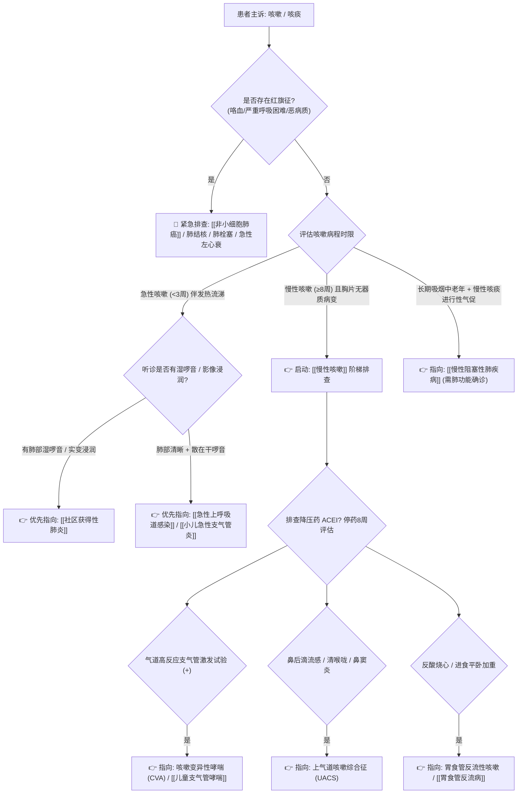

# 咳嗽与咳痰鉴别诊断树与临床排查规范

## 一、 主诉特征与接诊问诊要点 (病程时间三阶梯)
咳嗽是呼吸系统最常见的防御反射与疾病信号。门诊首诊必须严格按照**病程时限**划定诊断方向：
1. **急性咳嗽（< 3周）**：多见于 [[急性上呼吸道感染]]、[[小儿急性支气管炎]]、急性鼻窦炎、急性哮喘发作。
2. **亚急性咳嗽（3～8周）**：多见于感染后咳嗽（PIC，感冒后顽固性刺激性干咳）、细菌性鼻窦炎、哮喘前兆。
3. **慢性咳嗽（≥ 8周，胸片或肺部CT无明显器质性病变）**：四大常见病因占 80% 以上（咳嗽变异性哮喘 CVA、上气道咳嗽综合征 UACS、嗜酸粒细胞性支气管炎 EB、胃食管反流性咳嗽 GERC）。
4. **问诊关键细节**：
   - 是否服用 ACEI 类降压药物（如依那普利、卡托普利——致咳率高达10-20%）；
   - 痰液性质：铁锈色痰（肺炎链球菌）、砖红色胶冻样痰（克雷伯杆菌）、大量脓臭痰（支气管扩张/肺脓肿）、粉红色泡沫痰（急性肺水肿/左心衰）；
   - 昼夜节律：夜间及清晨刺激性剧咳常提示 CVA、GERC 或心功能不全。

---

## 二、 咳嗽呼吸系统致命“红旗征” (Red Flags)
> [!CAUTION] 出现以下红旗征之一，必须立即行胸部高分辨 CT、支气管镜或急诊处理：
- **咯血或痰中带血丝**：持续性痰中带血伴进行性消瘦、吸烟史，高度警惕 [[非小细胞肺癌]] 或活动性肺结核；
- **重度呼吸困难与发绀**：静息时即呼吸费力、口唇发绀、氧饱和度 < 90%（警惕重症肺炎、重度哮喘大发作、大面积肺栓塞）；
- **大量粉红色泡沫样痰**：伴端坐呼吸、大汗淋漓、双肺满布湿啰音（提示急性左心衰竭/心源性哮喘）；
- **大量脓臭痰伴高热消瘦**：警惕肺脓肿、支气管扩张合并坏死性厌氧菌感染；
- **声嘶伴刺激性呛咳**：警惕纵隔肿物、中央型肺癌压迫喉返神经。

---

## 三、 门诊阶梯鉴别诊断思维路径

---

## 四、 必备实验室与检查规范
1. **第一线排查**：胸部 X 线平片或低剂量高分辨 CT（排除肺部浸润、肿瘤、结核）。
2. **气道功能与过敏原评估**：
   - 肺通气功能测定 + 支气管舒张/激发试验（明确气流受限与气道高反应性）；
   - 呼出气一氧化氮（FeNO）及诱导痰嗜酸粒细胞比例（诊断嗜酸性气道炎症）。
3. **胃肠动力检查**：疑诊 GERC 者行 24小时食管阻抗-pH 监测。

---

## 五、 门诊前置处方与安全禁忌红线
1. 🛑 **严禁对慢性咳嗽无感染指征患者长期经验性开具高级抗生素（如阿奇霉素、左氧氟沙星）**。
2. 🛑 **多痰、痰液黏稠患者，严禁单用强效中枢镇咳药（如可待因、右美沙芬）**，会导致痰液潴留排不出，诱发呼吸道阻塞、肺不张及加重肺部感染。
3. 🛑 **服用普利类（ACEI）降压药出现干咳的患者，应遵医嘱平稳替换为沙坦类（ARB）降压药，不可盲目加服止咳药**。
