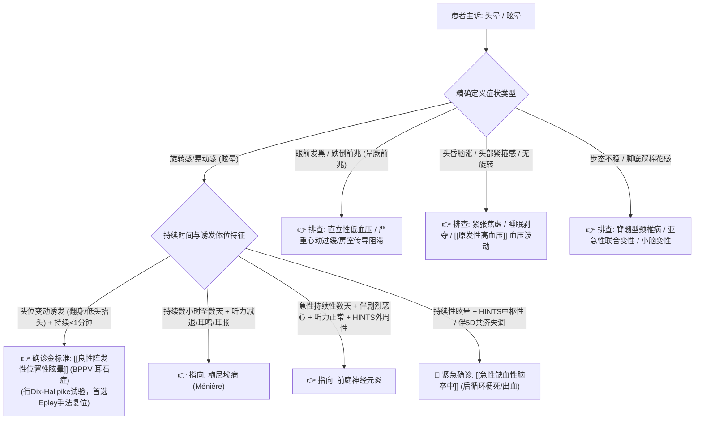

# 头晕与眩晕鉴别诊断树与临床排查规范

## 一、 主诉特征与接诊问诊要点 (症状四分类问诊模型)
头晕/眩晕是全科门诊排名前三的高频主诉。接诊首要任务是纠正“只要头晕就诊断为颈椎病或脑供血不足”的错误惯性，准确区分为以下四类：
1. **眩晕 (Vertigo)**：天旋地转、自身或外界景物晃动感，伴眼震、自主神经症状（恶心呕吐）。多为前庭系统受累。
2. **头昏 (Lightheadedness)**：头沉、昏昏沉沉、头部发紧发胀，无运动幻觉。多见于慢性疲劳、睡眠障碍、焦虑抑郁、高血压。
3. **晕厥前兆 (Presyncope)**：眼前发黑、视物模糊、四肢无力、即将跌倒感。提示大脑一过性广泛脑灌注不足（直立性低血压、心律失常）。
4. **不稳感 (Disequilibrium)**：行走时步态不稳、醉酒样步态、脚踏棉花感。提示小脑共济失调、深感觉障碍、锥体外系病变。

---

## 二、 眩晕中枢性致命“红旗征” (后循环小脑脑干卒中排雷)
> [!CAUTION] 临床重点在于鉴别“良性外周前庭性眩晕”与“恶性中枢神经源性眩晕”。出现以下红旗征必须启动卒中绿色通道：
- **查体发现局灶性神经系统定位体征**：复视、构音障碍、吞咽困难、共济失调、偏身麻木或偏瘫（后循环卒中“5D”特征：Dizziness, Diplopia, Dysarthria, Dysphagia, Dysmetria）；
- **恶性眼震表现**：自发性垂直眼震（上跳或下跳）、纯旋转性眼震、或注视方向改变的双向凝视麻痹性眼震（均提示脑干小脑中枢损害）；
- **床旁 HINTS 检查提示中枢性**（满足以下三项中任意一项）：
  1. **头脉冲试验 (Head Impulse Test, HIT)**：阴性（正常，即无矫正性扫视，强烈指向中枢卒中）；
  2. **眼震 (Nystagmus)**：方向改变的双向眼震；
  3. **眼偏斜反应 (Test of Skew)**：遮盖-去遮盖时出现垂直偏斜。
- **高龄伴心脑血管危险因素**（高血压、糖尿病、房颤、吸烟）的新发持续性不稳。

---

## 三、 门诊阶梯鉴别诊断思维路径

---

## 四、 必备实验室与物理查体规范
1. **床旁查体核心三步（物理体检）**：
   - Dix-Hallpike 试验（后半规管耳石症金标准）及 Roll 试验（水平半规管耳石症）；
   - 床旁 HINTS 三联检查（HIT、Nystagmus、Test of Skew）；
   - 指鼻试验、轮替运动、闭目难立征（Romberg征）。
2. **实验室与影像学**：
   - 卧立位血压测定（排查体位性低血压）；
   - 疑诊中枢性者急查颅脑 MRI + DWI（弥散加权成像排查超早期小脑脑干小梗死，CT 对后循环易漏诊）。

---

## 五、 门诊前置处方与安全禁忌红线
1. 🛑 **耳石症（BPPV）的首选根治措施是“手法复位治疗”（如 Epley 或 Barbecue 手法），严禁仅依靠静脉输注扩血管药物（如银杏叶、丹参）作为主要治疗**。
2. 🛑 **前庭抑制剂（如异丙嗪、地芬尼多）仅限用于急性剧烈呕吐发作期（严格控制在 ≤ 3 天），严禁长期连续使用**，否则会阻碍前庭中枢代偿功能的自行恢复。
3. 🛑 **中枢性后循环缺血患者，严禁实施粗暴的颈部旋转推拿或过度牵引**，防止诱发椎动脉或基底动脉夹层撕裂致死。
