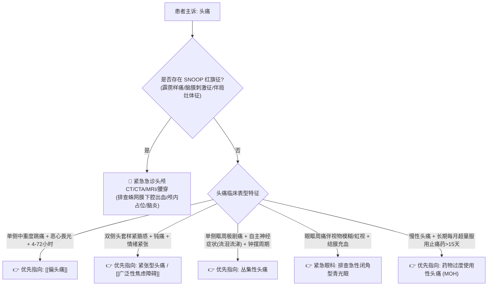

# 头痛鉴别诊断树与临床排查规范

## 一、 主诉特征与接诊问诊要点 (SNOOP 红旗征筛查法)
头痛是门诊就诊率极高的主诉，临床的核心首要任务是**区分“良性原发性头痛”与“致命性继发性头痛”**：
1. **起病急缓与达峰时间**：数秒至数分钟内达峰的“霹雳样剧痛”（Thunderclap headache）必须按急症排查蛛网膜下腔出血。
2. **疼痛性质与部位**：
   - 搏动性、中重度跳痛，多单侧，伴恶心畏光：典型 [[偏头痛]]；
   - 双侧紧箍感、压迫感，无搏动性，与疲劳焦虑相关：紧张型头痛；
   - 伴发热、喷射性呕吐、进行性加重：颅内占位或中枢神经系统感染；
   - 颞部搏动减弱伴下颌咀嚼痛（中老年人）：警惕颞动脉炎。
3. **伴随症状与神经系统体征**：视力骤降、复视、肢体麻木无力、失语等。

---

## 二、 继发性头痛致命“红旗征” (SNOOP 原则)
> [!CAUTION] 具备以下任何一项特征的头痛，必须立即行颅脑 CT / MRI / 腰穿排查，严禁仅按普通偏头痛对症处置：
- **S (Systemic symptoms)**：伴高热、意识障碍、皮疹或已知恶性肿瘤病史；
- **N (Neurologic signs)**：查体发现脑膜刺激征阳性（颈项强直、Kernig征阳性）、视乳头水肿、病理征阳性或新发局灶性神经功能缺损（提示脑出血、[[急性缺血性脑卒中]]、脑脓肿）；
- **O (Onset sudden)**：突发霹雳样头痛（瞬间达到极量剧痛，提示动脉瘤破裂致蛛网膜下腔出血 SAH）；
- **O (Older age)**：年龄 > 50 岁首次发生新发严重头痛（排查颅内占位、巨细胞动脉炎/颞动脉炎）；
- **P (Pattern change / Positional)**：头痛性质显著改变；或随体位明显变化（站立位加剧提示低颅压，平卧加剧晨起伴呕吐提示高颅压）。

---

## 三、 门诊阶梯鉴别诊断思维路径

---

## 四、 必备检验与排查规范
1. **急危重排查**：
   - 急诊头颅平扫 CT：排除急性蛛网膜下腔出血（发病6小时内敏感度近100%）、急性脑出血、大面积脑水肿；
   - 腰椎穿刺术：CT阴性但高度怀疑 SAH 者行脑脊液均匀血性及三管对比试验。
2. **原发性头痛评估**：
   - 详细记录“头痛日记”，计算每月头痛天数，指导预防性用药。

---

## 五、 门诊前置处方与安全禁忌红线
1. 🛑 **麦角胺类及曲普坦类药物（如佐米曲普坦）在缺血性心脑血管疾病（心梗、冠心病、缺血性脑卒中、未控制高血压）患者中绝对禁用**，防止诱发冠脉或脑血管痉挛导致恶性事件。
2. 🛑 **严禁对慢性原发性头痛患者长期不限量开具复方镇痛药（如去痛片、散利痛）**，必须警惕并阻断药物过度使用性头痛（MOH）。
