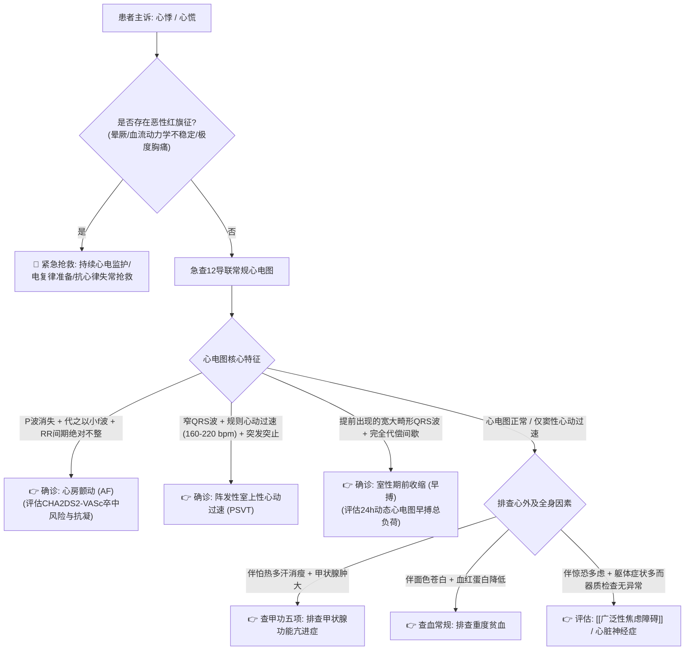

# 心悸鉴别诊断树与临床排查规范

## 一、 主诉特征与接诊问诊要点 (自律性异常 vs 器质性心律失常)
心悸是一种自觉心脏跳动的不适感或心慌感。心脏搏动过快、过慢或不规则均可引起。临床核心在于**辨明是良性功能性心悸、器质性心律失常还是内分泌代谢异常**：
1. **发作形式与心律规整度**：
   - 突发突止、心率极快（160～220 次/分）且节律规整：典型阵发性室上性心动过速 (PSVT)；
   - 心跳绝对不齐、强弱不等、快慢不一：心房颤动 (AF，尤其常见于高血压、冠心病 [[动脉粥样硬化性心血管疾病]] 及老年患者)；
   - “心脏停跳感”、“落空感”或偶发重重一跳：房性或室性期前收缩（早搏）；
   - 逐渐加快、逐渐减慢，与情绪激动或运动相关：窦性心动过速。
2. **伴随全身症状问诊**：
   - 伴怕热、多汗、消瘦、手抖、多食易饥：甲状腺功能亢进症（甲亢）；
   - 伴头昏、乏力、面色苍白：中重度贫血；
   - 伴惊恐不安、深吸气叹息、手足发麻：惊恐发作、过度通气、[[广泛性焦虑障碍]]。

---

## 二、 心律失常致命“红旗征” (Red Flags)
> [!CAUTION] 心悸患者若合并以下任一表现，提示高危恶性心律失常，必须立即急诊心电监护与除颤待命：
- **心悸伴黑矇、晕厥（Syncope）或阿-斯综合征 (Adams-Stokes)**：强烈提示恶性室性心动过速 (VT)、心室颤动 (VF)、病态窦房结综合征窦性停搏或三度房室传导阻滞；
- **心悸伴急性胸痛、呼吸困难或急性肺水肿**：警惕急性心肌梗死合并严重心律失常；
- **血流动力学不稳定**：心悸发作时收缩压 < 90 mmHg、大汗淋漓、末梢发绀；
- **心电图显示明显异常**：QT 间期显著延长（QTc > 500 ms，警惕尖端扭转型室速 TdP）、Brugada 波、预激综合征伴快速房颤。

---

## 三、 门诊阶梯鉴别诊断思维路径

---

## 四、 必备实验室与检查规范
1. **基础必查**：
   - 12 导联同步心电图（发作时记录最具诊断价值）；
   - 24 小时动态心电图 (Holter)：捕捉偶发心律失常、评估早搏数量与最慢/最快心率；
   - 血常规、血清电解质（尤其是血钾、血镁，低钾低镁是心律失常重要诱因）；
   - 甲状腺功能全套（TSH、FT3、FT4）。
2. **结构性评估**：超声心动图（评估心脏结构、房室大小、射血分数与瓣膜情况）。

---

## 五、 门诊前置处方与安全禁忌红线
1. 🛑 **心房颤动患者切忌单纯依靠镇静药应付，必须按规范进行 CHA₂DS₂-VASc 卒中风险评估，达标者必须按指南规范启动抗凝（如新型口服抗凝药 NOAC）预防脑梗死**！
2. 🛑 **预激综合征伴心房颤动患者，绝对禁用洋地黄制剂（地高辛）、维拉帕米及普通 β 受体阻滞剂**，因为这些药物会阻滞房室结传导，促使激动主要沿旁路极快下传心室，诱发室颤致死！
3. 🛑 **QT 间期延长患者，严禁使用延长 QT 间期的抗心律失常药物或抗感染药（如胺碘酮、红霉素/阿奇霉素、莫西沙星联用）**，谨防恶性室速（尖端扭转型室速 TdP）。
