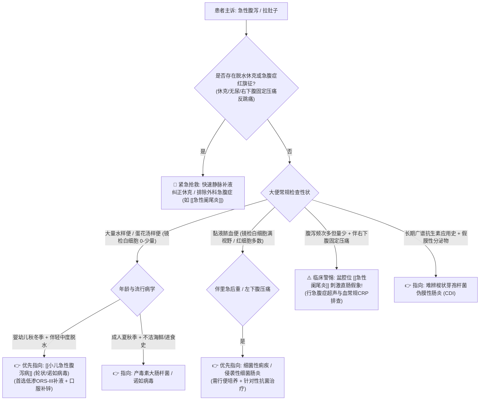

# 急性腹泻鉴别诊断树与临床排查规范

## 一、 主诉特征与接诊问诊要点 (便质、频次与流行病学)
急性腹泻指排便次数明显超过平时习惯（≥3次/天），粪质稀薄、含水量增加（>85%），病程通常在 2 周以内。临床问诊的核心要点：
1. **粪便性状**：
   - 大量黄色水样便/蛋花汤样便，无腥臭，偶伴呕吐：轮状病毒、诺如病毒、产毒素大肠埃希菌；
   - 米泔水样便伴剧烈无痛性腹泻及呕吐：高度警惕烈性传染病霍乱；
   - 黏液脓血便伴里急后重（下坠感）、左下腹压痛：细菌性痢疾（志贺菌）、侵袭性大肠埃希菌、溃疡性结肠炎；
   - 果酱样血便伴阵发性哭闹（婴幼儿）：警惕肠套叠。
2. **脱水与电解质紊乱评估**：尿量显著减少、眼眶凹陷、口唇干燥、皮肤弹性变差、毛细血管再充盈时间（CRT）延长。
3. **特别警惕外科陷阱**：**盆腔位或低位 [[急性阑尾炎]] 阑尾化脓坏死可直接刺激直肠前壁，表现为排便频次增加、里急后重感，极易误诊为单纯急性肠炎！**

---

## 二、 急性腹泻致命“红旗征” (Red Flags)
> [!CAUTION] 具备以下任何一项特征，必须立即开启重症补液救治或外科急诊探查：
- **重度脱水合并低血容量休克**：嗜睡或昏迷、脉搏微弱或不能扪及、四肢发凉、收缩压显著下降、无尿；
- **腹膜刺激征（压痛、肌紧张、反跳痛）**：急性腹泻患者若出现局限性固定压痛（如右下腹压痛）或板状腹，必须首先排查阑尾炎穿孔或坏疽性肠炎，绝不能当作普通肠炎放行；
- **儿童果酱样黏液血便伴腹部腊肠样包块**：典型婴幼儿急性肠套叠指征；
- **溶血尿毒综合征 (HUS) 迹象**：腹泻后出现进行性贫血、血小板锐减、急性肾损伤无尿（多见于 EHEC O157:H7 产志贺毒素大肠杆菌感染）。

---

## 三、 门诊阶梯鉴别诊断思维路径

---

## 四、 必备实验室与检查规范
1. **基础必查**：
   - 粪便常规 + 隐血试验（OB）+ 镜检（白细胞、红细胞、虫卵、原虫）；
   - 电解质分析（重点监测血钾、钠、氯，警惕低钾血症诱发心律失常与肠麻痹）；
   - 肾功能（BUN、Cr 评估肾前性氮质血症）。
2. **靶向排查**：
   - 粪便轮状病毒/诺如病毒抗原快速检测；
   - 粪便细菌培养及药敏试验（用于重症、血便或免疫缺陷患者）；
   - 阑尾区及全腹急腹症超声（对伴有腹痛者必查）。

---

## 五、 门诊前置处方与安全禁忌红线
1. 🛑 **急性腹泻的基石治疗是“预防和纠正脱水”（首选低渗口服补液盐 ORS-III），严禁一发病就盲目给予强效止泻药（如洛哌丁胺、地芬诺酯、易蒙停）**！尤其是侵袭性细菌性痢疾与小儿腹泻中绝对禁用洛哌丁胺，防止毒素无法排出导致中毒性巨结肠甚至死亡。
2. 🛑 **严禁对病毒性水样腹泻常规开具诺氟沙星、环丙沙星等喹诺酮类抗菌药**（18 岁以下儿童禁用氟喹诺酮类），会导致肠道微生态严重失衡。
3. 🛑 **小儿急性感染性腹泻，指南强推荐全程口服补充元素锌（10～20 mg/天，持续 10～14 天）**，可显著缩短病程并修复受损肠黏膜。
