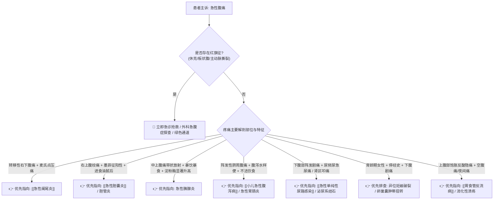

# 急性腹痛鉴别诊断树与临床排查规范

## 一、 主诉特征与接诊问诊要点 (OLDCARTS 模型)
急性腹痛是门诊与急诊最常见的急性主诉之一。接诊医生需在 3 分钟内明确疼痛的关键特征：
1. **起病缓急与诱因**：暴饮暴食/高脂餐（胰腺炎、胆囊炎）、剧烈运动后（肠扭转、黄体破裂）、酗酒、服药史（NSAIDs致胃穿孔）。
2. **疼痛部位与转移规律**：
   - 转移性右下腹痛：先脐周/上腹隐痛，数小时后固定于右下腹（[[急性阑尾炎]] 典型特征）；
   - 右上腹阵发性绞痛向右肩背放射：[[急性胆囊炎]]、胆石症；
   - 中上腹刀割样剧痛向左腰背呈带状放射：急性胰腺炎；
   - 突发全腹刀割样剧痛并迅速蔓延：消化道穿孔；
   - 下腹部坠痛伴停经：育龄期女性警惕异位妊娠（宫外孕）破裂。
3. **疼痛性质**：钝痛、胀痛、绞痛、阵发性加剧、持续性加重。

---

## 二、 致命性“红旗征” (Red Flags 强制排雷)
> [!CAUTION] 凡出现以下红旗征之一，禁止门诊普通留观，立即开启绿色通道、开通静脉通路并请外科/ICD 会诊：
- **血流动力学不稳定**：面色苍白、四肢厥冷、脉搏细弱、收缩压 < 90 mmHg（警惕腹腔内实质脏器破裂大出血、休克型重症胰腺炎、宫外孕破裂）；
- **全腹膜刺激征（板状腹）**：全腹肌紧张如木板、全腹明显压痛及反跳痛（提示消化道穿孔、弥漫性化脓性腹膜炎）；
- **突发撕裂样剧痛伴背痛**：突发胸背或腹背部撕裂样痛，伴双上肢血压不对称（高度疑似主动脉夹层累及腹主动脉）；
- **老年人剧烈腹痛但腹部体征轻微（“症状与体征分离”）**：剧烈腹部绞痛但压痛不明显，伴房颤病史（高度怀疑肠系膜上动脉栓塞/肠坏死）。

---

## 三、 门诊阶梯鉴别诊断思维路径

---

## 四、 必备实验室与影像学组合
1. **基础必查**：
   - 血常规 + CRP：白细胞及中性粒细胞计数升高提示感染/炎症；
   - 尿常规 + 尿 HCG：所有育龄期女性腹痛**必须排查尿 HCG**排除妊娠；尿白细胞/红细胞辅助排查泌尿系病变。
2. **靶向排查**：
   - 腹部急腹症超声（阑尾区、肝胆胰脾、双肾输尿管、妇科附件盆腔积液）；
   - 立位腹部平片（排查膈下游离气体指示穿孔、阶梯状液气平面指示肠梗阻）；
   - 急查血尿淀粉酶、脂肪酶（排查胰腺炎）；
   - 心电图与肌钙蛋白（高危中老年排查不典型下壁心肌梗死 [[急性ST段抬高型心肌梗死]]）。

---

## 五、 门诊前置处方与安全禁忌红线
1. 🛑 **严禁在未确诊前盲目大剂量使用强效麻醉镇痛药（吗啡、哌替啶等）**：易掩盖腹膜刺激体征，延误急性阑尾炎穿孔或坏死的手术时机。
2. 🛑 **急性机械性肠梗阻或急腹症穿孔怀疑者，严禁使用泻药或强行灌肠**。
3. 🛑 **胃肠痉挛性绞痛可选用解痉药（如间苯三酚），但必须在排除外科急腹症的前提下进行**。
