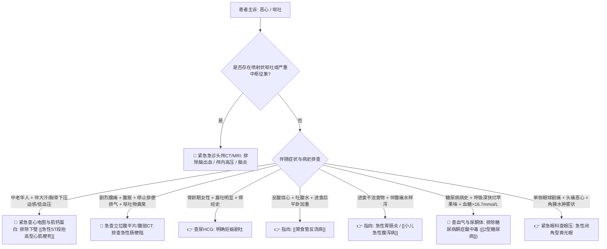

# 恶心与呕吐鉴别诊断树与临床排查规范

## 一、 主诉特征与接诊问诊要点 (消化系统 vs 颅内中枢 vs 全身代谢)
恶心常为呕吐的前驱感觉，呕吐是通过胃强烈收缩将胃内容物经食管及口腔排出的反射动作。接诊医生需快速鉴别是局部胃肠道病变还是中枢/全身系统危疾的投射：
1. **呕吐发生的形式**：
   - 恶心伴随、吐后胃部舒适感：多见于胃炎、消化不良、[[胃食管反流病]]；
   - **喷射状呕吐（不伴恶心、骤然剧烈喷出）**：特征性提示颅内压增高（脑出血、脑炎、脑水肿、脑肿瘤）；
   - 饱餐后或夜间大量呕吐宿食（带发酵酸臭味）：提示幽门梗阻。
2. **呕吐物的性质与颜色**：
   - 咖啡渣样或暗红血性物：上消化道出血；
   - 含有大量黄绿色胆汁：频繁剧烈呕吐累及十二指肠以下，但若婴儿喷射胆汁呕吐需排查先天性肠旋转不良；
   - 粪臭样呕吐物：低位机械性肠梗阻。
3. **全身及特殊背景问诊**：
   - 育龄期女性晨起干呕伴停经：早孕反应；
   - 糖尿病患者恶心呕吐伴呼吸深大带烂苹果味：糖尿病酮症酸中毒 (DKA)；
   - 中老年高血压患者突发恶心呕吐伴上腹不适及大汗：必须排查下壁 [[急性ST段抬高型心肌梗死]]；
   - 用药史：化疗药、二甲双胍起始期、阿片类、洋地黄（地高辛中毒）。

---

## 二、 恶心呕吐致命“红旗征” (Red Flags)
> [!CAUTION] 存在以下特征者，提示严重颅脑、心血管或急腹症病变，禁止仅用止吐药应付：
- **中枢神经系统损害征象**：剧烈头痛伴喷射状呕吐、视物模糊、视乳头水肿、意识障碍、脑膜刺激征阳性（提示颅内高压危机）；
- **心血管不典型表现**：无明显诱因的恶心、频繁干呕，伴胸闷、心悸、冷汗、低血压，心电图导联异常（提示急性心肌梗死）；
- **急腹症性梗阻或腹膜炎**：呕吐频繁伴剧烈阵发性腹痛、全腹胀痛、停止排气排便（提示急性肠梗阻、肠绞窄坏死）；
- **重度电解质酸碱紊乱**：低钾血症（四肢软瘫、心电图ST-T压低U波出现）、低钠脑病。

---

## 三、 门诊阶梯鉴别诊断思维路径

---

## 四、 必备实验室与检查规范
1. **基础必查**：
   - 血糖、电解质（K⁺, Na⁺, Cl⁻, HCO₃⁻）及肾功能（评估脱水与酸碱失衡）；
   - 尿常规与尿酮体（排查酮症与妊娠）；
   - 12导联心电图（常规筛查老年人无痛性/非典型心梗）。
2. **靶向排查**：
   - 胃镜或钡餐透视（评估食管胃黏膜病变及幽门梗阻）；
   - 头颅 CT / 腹部 CT。

---

## 五、 门诊前置处方与安全禁忌红线
1. 🛑 **在未明确病因前，严禁盲目给肠梗阻患者使用胃肠促动力药（如甲氧氯普胺/胃复安、莫沙必利）**，会导致梗阻近端肠管强烈蠕动，诱发肠坏死与肠穿孔！
2. 🛑 **甲氧氯普胺（胃复安）小儿与孕妇应谨慎使用**，儿童极易出现锥体外系反应（急性肌张力障碍、斜颈、角弓反张）；儿童严重呕吐应优先对因支持与补液。
