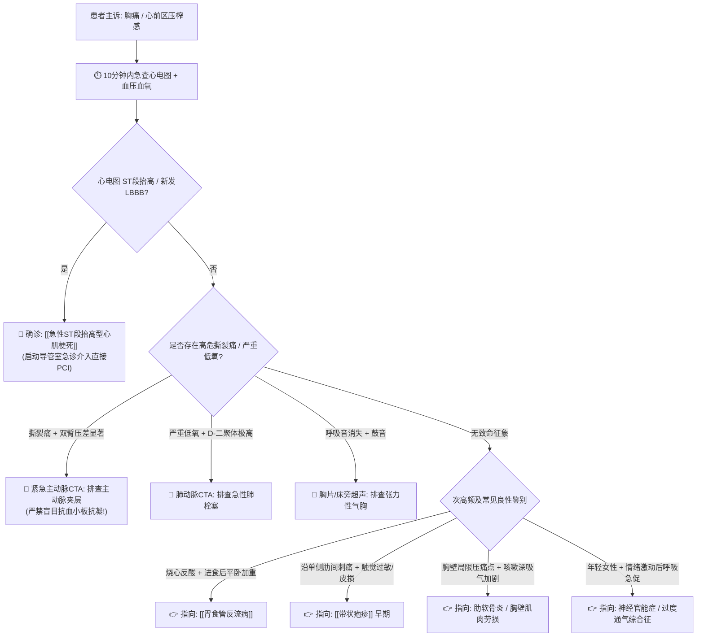

# 胸痛鉴别诊断树与临床排查规范

## 一、 主诉特征与接诊问诊要点 (胸痛中心时效规范)
胸痛是临床最具危险性的急重症主诉之一。接诊医生必须遵循“**优先排除致死性疾病**”的原则，就诊 10 分钟内完成首份心电图（FMC-to-ECG ≤ 10 min）：
1. **疼痛部位与性质**：
   - 胸骨后压榨样、紧缩感或窒息感，伴出汗：典型心肌缺血/心梗表现；
   - 突发前胸或背部撕裂样、刀割样剧痛：典型主动脉夹层；
   - 针刺样或胸膜性锐痛，深呼吸或咳嗽时加剧：胸膜炎、肺栓塞、气胸；
   - 胸骨后烧灼样痛，平卧加重、直立或进食碱性药物减轻：反流性食管炎；
   - 沿肋间神经单侧分布的灼痛或刀割样痛，伴触觉过敏：带状疱疹前驱期。
2. **放射部位**：向左肩、左臂内侧、颈咽部或下颌部放射提示冠心病心绞痛。

---

## 二、 致命性“红旗征” (致死性胸痛五联征排查)
> [!CAUTION] 凡就诊胸痛患者，必须以最快速度排查以下 5 大致死性病因：
- **急性冠脉综合征 (ACS / [[急性ST段抬高型心肌梗死]])**：持续胸骨后压榨性剧痛 > 20分钟，含服硝酸甘油不缓解，伴大汗、濒死感；
- **主动脉夹层 (Aortic Dissection)**：突发胸背部极度撕裂样剧痛，双上肢收缩压差 > 20 mmHg，可伴主动脉瓣关闭不全杂音；
- **急性肺栓塞 (PE)**：胸痛伴突发呼吸困难、咯血、低氧血症（胸痛-咯血-呼吸困难三联征），伴单侧下肢肿胀深静脉血栓征象；
- **张力性气胸 (Tension Pneumothorax)**：突发一侧剧烈胸痛伴进行性呼吸困难，气管向健侧移位，患侧呼吸音消失及鼓音；
- **心包填塞 (Cardiac Tamponade)**：心音遥远、颈静脉怒张、奇脉与低血压（Beck 三联征）。

---

## 三、 门诊阶梯鉴别诊断思维路径

---

## 四、 必备检验检查规范
1. **急诊第一序列**：
   - 18导联常规心电图（涵盖正后壁与右室导联）；
   - 高敏肌钙蛋白（hs-cTnI / hs-cTnT）、CK-MB；
   - D-二聚体（D-Dimer）定量测定；
   - 床旁床头胸部 X 线或快速超声心动图。
2. **第二序列鉴别**：
   - 增强主动脉 CTA、肺动脉 CTA 或上消化道内镜检查。

---

## 五、 门诊前置处方与安全禁忌红线
1. 🛑 **在未明确排除主动脉夹层前，严禁盲目给予大剂量阿司匹林、替格瑞洛抗血小板及低分子肝素抗凝**！一旦误将主动脉夹层作为心梗双抗抗凝，极易诱发夹层破裂致猝死。
2. 🛑 **下壁合并右室心肌梗死患者，严禁盲目含服硝酸甘油**（会导致右室前负荷骤降，诱发严重难治性低血压休克）。
