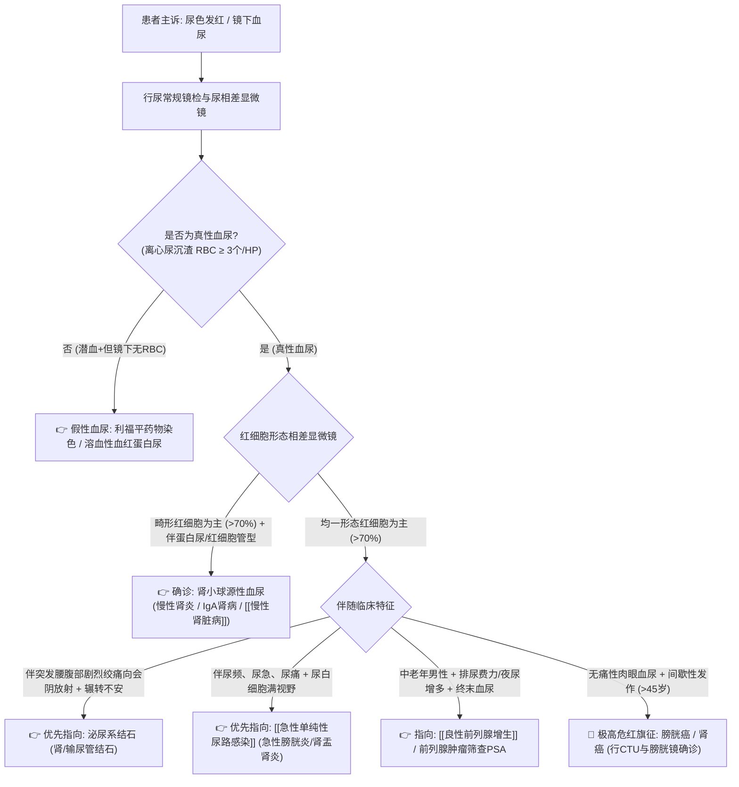

# 血尿鉴别诊断树与临床排查规范

## 一、 主诉特征与接诊问诊要点 (肉眼 vs 镜下，肾小球 vs 非肾小球)
血尿是指尿液中红细胞排泄异常增多。离心沉渣每高倍视野（HP）红细胞 ≥ 3 个即为镜下血尿；每升尿含血量超过 1 ml 即呈现洗肉水样、肉眼红色称为肉眼血尿。问诊核心在于**三步锁定病因**：
1. **真性血尿与假性血尿鉴别**：
   - 排除食物/药物染色（利福平、酚酞致尿红，但镜检无红细胞）；
   - 排除血红蛋白尿/肌红蛋白尿（潜血强阳性但镜下无红细胞，常见于挤压综合征、溶血）；
   - 排除月经血污染。
2. **尿三杯试验定位出血解剖部位**：
   - 初血尿（前段有血）：病变在前尿道；
   - 终末血尿（排尿后段加重）：病变在膀胱颈部、膀胱三角区或后尿道、前列腺；
   - 全程血尿（全程均匀红色）：病变在膀胱、输尿管或肾脏。
3. **红细胞形态学（相差显微镜）区分来源**：
   - 畸形红细胞为主（多形型 > 70%）：**肾小球源性血尿**（肾炎、肾病）；
   - 均一正常形态红细胞为主（> 70%）：**非肾小球源性血尿**（结石、感染、肿瘤、畸形）。

---

## 二、 泌尿系统致命“红旗征” (Red Flags)
> [!CAUTION] 具备以下任何一项特征，必须高度警惕恶性肿瘤或急性进行性肾损伤：
- **中老年人无痛性间歇性肉眼全程血尿**：**这是膀胱癌、肾盂癌或肾癌的最高级警示红旗征**，绝对不能当作普通尿路感染轻易用药应付，必须强制行泌尿系增强 CT (CTU) 与膀胱镜检查！
- **血尿伴迅速出现少尿、无尿、肌酐成倍飙升与水肿**：警惕急进性肾小球肾炎 (RPGN) 或恶性小动脉硬化急性肾功能衰竭；
- **肉眼血尿伴排出长条形蚯蚓状血块**：多提示输尿管上段或肾盂大量出血后在输尿管内凝固成型。

---

## 三、 门诊阶梯鉴别诊断思维路径

---

## 四、 必备实验室与检查规范
1. **基础必查**：
   - 尿常规 + 尿红细胞形态分析（新鲜晨尿相差显微镜镜检）；
   - 24 小时尿蛋白定量（区分单纯血尿还是合并肾小球蛋白尿）；
   - 肾功能（Cr, BUN, eGFR）、血尿酸。
2. **影像学与内镜金标准**：
   - 泌尿系统高分辨彩色多普勒超声（双肾、输尿管、膀胱、前列腺）；
   - 泌尿系 CT 尿路造影 (CTU)；
   - 膀胱尿道镜检查（确诊膀胱肿瘤的金标准）。

---

## 五、 门诊前置处方与安全禁忌红线
1. 🛑 **严禁对无痛性肉眼血尿的中老年患者，在未做全面排查前盲目仅开具抗菌药物或止血药后让患者回家观察**，极易导致早期膀胱癌或肾脏肿瘤延误至浸润晚期！
2. 🛑 **急性肾小球肾炎导致血尿的患者，严禁盲目大剂量应用具有潜在肾毒性的药物（如氨基糖苷类抗生素庆大霉素、妥布霉素及非甾体抗炎药）**。
3. 🛑 **泌尿系结石合并严重肾积水并发感染者，严禁单纯药物排石，必须紧急解除梗阻引流抗休克**。
